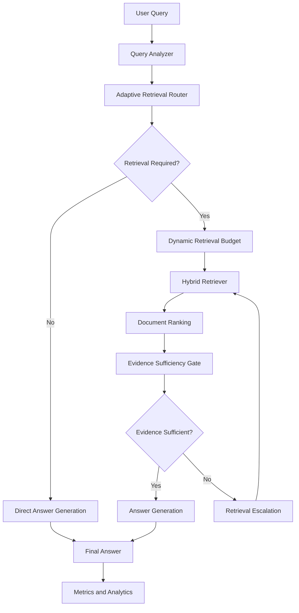

# RetrievalIQ — Adaptive Retrieval Intelligence Engine

<p align="center">
  <b>Don't retrieve more. Retrieve smarter.</b>
</p>

<p align="center">
  An intelligent, cost-aware retrieval system that dynamically determines whether a query requires external knowledge, how much context to retrieve, and when to stop retrieving.
</p>

<p align="center">
  
  
  
  
  
</p>

---

## Overview

Traditional Retrieval-Augmented Generation (RAG) systems retrieve external documents for almost every incoming query, regardless of whether additional information is necessary.

This creates unnecessary computational overhead, increases response latency, consumes additional tokens, and raises operational costs.

**RetrievalIQ** introduces an adaptive retrieval architecture that intelligently determines the retrieval requirements of each query.

Instead of using a fixed retrieval strategy, the system dynamically decides:

- Whether external retrieval is necessary.
- How many document chunks should be retrieved.
- Whether the retrieved context contains sufficient evidence.
- Whether additional retrieval is required.
- When the system should stop retrieving and generate an answer.

The primary objective is to optimize the balance between answer quality, retrieval cost, and response latency.

## Problem Statement

Retrieving information for every query is inefficient, while retrieving too little information can result in incomplete or inaccurate answers.

A retrieval system should recognize the difference between simple factual questions, moderately complex questions, and queries requiring extensive external context.

RetrievalIQ addresses this challenge by introducing intelligent query routing and dynamic retrieval-budget allocation.

## Key Features

### 1. Adaptive Query Routing

Analyzes incoming queries and estimates their complexity to determine whether external knowledge is required.

### 2. Dynamic Retrieval Budgeting

Allocates retrieval resources according to query requirements.

Supported retrieval budgets:

| Budget | Strategy |
|---|---|
| 0 chunks | Direct answering |
| 2 chunks | Lightweight retrieval |
| 4 chunks | Moderate retrieval |
| 7 chunks | Deep retrieval |

### 3. Hybrid Information Retrieval

Combines multiple information retrieval techniques to improve document discovery:

- TF-IDF
- BM25
- Reciprocal Rank Fusion (RRF)

### 4. Evidence Sufficiency Evaluation

Evaluates whether the retrieved information provides sufficient context to answer a query.

If the evidence is insufficient, the system can initiate an additional retrieval pass within a bounded budget.

### 5. Intelligent Retrieval Escalation

Implements an iterative retrieval workflow:

1. Retrieve the initial document set.
2. Evaluate evidence sufficiency.
3. Identify missing information.
4. Increase the retrieval budget when necessary.
5. Stop when sufficient evidence is available or the retrieval budget is exhausted.

### 6. Multi-Strategy Benchmarking

Compares adaptive retrieval with conventional retrieval strategies using accuracy, latency, and cost metrics.

### 7. Interactive Analytics Dashboard

Provides visual insights into query complexity, retrieval decisions, retrieved context, execution traces, and benchmark performance.

---

## System Architecture



## Technology Stack

| Component | Technology |
|---|---|
| Programming Language | Python |
| Query Analysis | Complexity-based routing |
| Information Retrieval | TF-IDF, BM25 |
| Ranking | Reciprocal Rank Fusion |
| Backend | FastAPI |
| Dashboard | Streamlit |
| Data Visualization | Plotly |
| Testing | Pytest |
| API Documentation | Swagger / OpenAPI |
| Containerization | Docker |

## Project Structure

```text
RetrievalIQ/
│
├── api.py
├── dashboard.py
├── README.md
├── pyproject.toml
├── Dockerfile
│
├── src/
│   └── retrievaliq/
│       ├── router.py
│       ├── retriever.py
│       ├── ranking.py
│       ├── evaluator.py
│       └── ...
│
├── data/
│   └── ...
│
├── tests/
│   └── ...
│
├── scripts/
│   └── ...
│
└── docs/
    └── ...
```

## Installation and Setup

### Prerequisites

- Python 3.10+
- Git
- pip

### 1. Clone the Repository

```bash
git clone <YOUR_REPOSITORY_URL>
cd RetrievalIQ
```

### 2. Create a Virtual Environment

**Windows**

```bash
python -m venv venv
venv\Scripts\activate
```

**macOS / Linux**

```bash
python3 -m venv venv
source venv/bin/activate
```

### 3. Install Dependencies

```bash
pip install -e ".[dev]"
```

### 4. Launch the Dashboard

```bash
streamlit run dashboard.py
```

Open the dashboard at:

```text
http://localhost:8501
```

### 5. Start the Backend API

```bash
uvicorn api:app --reload
```

API endpoint:

```text
http://localhost:8000
```

Interactive API documentation:

```text
http://localhost:8000/docs
```

### 6. Run Tests

```bash
pytest -q
```

---

## Dashboard Modules

### Overview
Displays the project introduction, system architecture, retrieval workflow, and key performance indicators.

### Query Lab
Allows users to submit queries and inspect:

- Query complexity.
- Retrieval decisions.
- Selected context budget.
- Retrieved document chunks.
- Evidence sufficiency.
- Final generated answers.
- Execution traces.

### Benchmark Studio
Compares different retrieval strategies and visualizes their performance.

### Architecture
Provides an overview of the internal components, information flow, and adaptive retrieval mechanism.

---

## Benchmarking Framework

RetrievalIQ evaluates four different retrieval strategies.

| Strategy | Description |
|---|---|
| Always Retrieve | Retrieves documents for every query |
| Never Retrieve | Answers without external retrieval |
| Fixed Top-K | Retrieves a constant number of chunks |
| Adaptive Retrieval | Dynamically determines retrieval requirements |

### Evaluation Metrics

**Answer Accuracy:** Measures the correctness and relevance of generated answers.

**Retrieval Cost:** Measures the computational and API expenses associated with retrieval.

**Response Latency:** Measures the time required to process a query.

**Retrieval Rate:** Measures the percentage of queries that trigger external retrieval.

**Context Efficiency:** Measures how effectively retrieved document chunks contribute to answer generation.

### Optimization Objective

RetrievalIQ aims to minimize a weighted objective:

\[
J = \alpha E + \beta C + \gamma L
\]

Where:

- \(E\) = Answer error
- \(C\) = Retrieval cost
- \(L\) = Response latency
- \(\alpha,\beta,\gamma\) = Optimization weights

The system aims to minimize computational overhead while maintaining an acceptable answer-quality threshold.

---

## Future Enhancements

- [ ] Supervised query-routing classifier.
- [ ] Sentence Transformer-based semantic retrieval.
- [ ] FAISS vector database integration.
- [ ] Cross-encoder document reranking.
- [ ] Multi-hop query decomposition.
- [ ] Confidence-calibrated retrieval decisions.
- [ ] Hallucination detection and citation verification.
- [ ] Real-time token and API cost tracking.
- [ ] Retrieval feedback and online learning.
- [ ] Distributed retrieval and caching.
- [ ] Advanced benchmarking across multiple datasets.

## Core Design Philosophy

RetrievalIQ treats information retrieval as a dynamic resource-allocation problem rather than a mandatory operation for every query.

By combining query complexity estimation, dynamic context budgeting, evidence evaluation, and retrieval escalation, the system aims to achieve a better balance between information quality and computational efficiency.

**Retrieve only when necessary. Retrieve as much as needed. Stop when the evidence is sufficient.**

---

## License

This project is licensed under the MIT License.